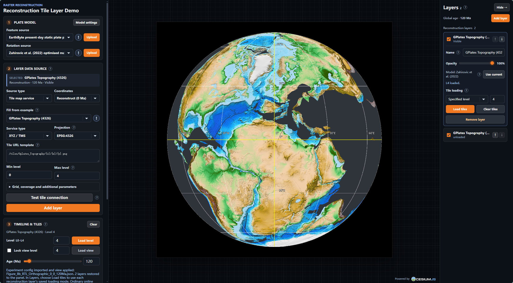

# Reconstructable Tile Layer (RTL)

English | [简体中文](README.zh-CN.md)

[](.github/workflows/deploy-pages.yml)
[](package.json)
[](LICENSE)

Browser-side paleogeographic reconstruction of published Web tile services in
Cesium.

This repository contains the TypeScript reference implementation accompanying
the manuscript _Reconstructable Tile Layers for Geological-Time-Driven Digital
Earth: Browser-side Paleogeographic Reconstruction of Published Web Tile
Services without Republication_.

RTL treats geological age and the selected rigid plate model as executable
layer state. It keeps a compatible published Web tile service as the imagery
source, assigns its tile content to polygonal plate domains, applies
ROT-derived finite rotations, masks boundary tiles in WebGL, and renders the
processed fragments in Cesium. The implementation reconstructs the published
visual layer; it does not recover source attributes, topology, feature
identities, or numerical raster values.

Two optional raster packages read numeric sources and adapt them to standard
Cesium imagery. The demo accepts
TIFF/GeoTIFF rasters and GeoJSON as ordinary vector layers; vector reconstruction
is not implemented. NetCDF is available only through the raster library's explicit
`/netcdf` API, not the demo upload controls. See the
[raster](apps/reconstructable-tile-layer-demo/README.md#local-scientific-rasters),
[GeoJSON](apps/reconstructable-tile-layer-demo/README.md#local-geojson-vectors), and
[reference-data validation](scripts/raster/README.md) guides.

## Demo

**Online demo:** [Launch the Reconstructable Tile Layer demo](https://computational-planet.github.io/reconstructable-tile-layer/).

**Quick start:** The default data sources work without loading a case config.

1. Choose the plate domains and ROT source under **Plate model**. Under **Layer data source**, choose **Tile map service**, retain **Reconstruct (0 Ma)**, and click **Add layer**.
2. Select that layer in the right-hand **Layers** panel. Set **Tile loading** to **Specified level**, choose a level, and click **Load tiles**. The left-hand **Timeline & tiles → Load level** performs the same operation.
3. Change **Age (Ma)** under **Timeline & tiles**. All reconstruction layers follow this global age; each retains its own plate model.

For local refinement, use **Load view** on the left or **Current view → Load tiles**
on the right. Leave **Lock view level** unchecked for automatic selection, or enable
it for an exact source level. View loading adds coverage without clearing existing
tiles. Ordinary imagery and GeoJSON load through Cesium and need no manual tile action.

The application in [`apps/reconstructable-tile-layer-demo`](apps/reconstructable-tile-layer-demo)
is the project demo started by `pnpm dev`. It:

- is powered by React, Vite, Cesium, the unified RTL package and two optional raster libraries;
- starts core-library Rollup watch builds through Turbo;
- supports interchangeable imagery services, plate-domain data, and ROT models;
- manages multiple reconstruction layers, ordinary imagery and GeoJSON in a
  collapsible, independently scrolling **Layers** panel, with age ranges for fixed layers;
- queries Macrostrat legends by area or point, maps reconstructed selections back
  to modern source regions, and groups results by colour;
- reproduces the paper workflow for age changes, source-level loading,
  view-aware refinement, reference overlays, 2D/perspective/orthographic views,
  and experiment JSON and screenshot export.

With workspace dependencies installed and libraries already built, launch the
demo from the repository root:

```sh
pnpm dev
```

After a fresh clone, or whenever `package.json` or `pnpm-lock.yaml` changes,
install the locked dependencies once before launching:

```sh
pnpm install --frozen-lockfile
pnpm build:packages
pnpm dev
```

Vite prints the local URL in the terminal. While the command remains running,
changes to core libraries are rebuilt automatically. Rebuild optional raster
packages with `pnpm build:packages` after changing their source or worker assets.



See the demo [English README](apps/reconstructable-tile-layer-demo/README.md) or
[Chinese README](apps/reconstructable-tile-layer-demo/README.zh-CN.md) for its
workflow, export behavior, and benchmark controller.

## Research materials

- Paper figure configurations: [English](paper_configs/README.md) ·
  [简体中文](paper_configs/README.zh-CN.md).
- Browser benchmark records used by the manuscript and supplementary material:
  [English](benchmark_records/README.md) ·
  [简体中文](benchmark_records/README.zh-CN.md).

Routine benchmark runs are written to the git-ignored `output/` directory. The
three reviewed evidence runs used by the paper are preserved separately under
`benchmark_records/`.

For repository development, use **Node.js 22** (the version used by the Pages build)
and **pnpm 9.0.5**. Package manifests declare Node.js 18+, but the repository's
locked build tools, including `rimraf@6`, require Node.js 20 or 22+.
The demo needs a browser with WebGL, Canvas, File/Blob and Worker support.

## Features

- Reconstructs compatible published WMS, WMTS, XYZ, and URL-template imagery
  without republishing the source service.
- Imports GPML, GPMLZ, XML, custom JSON plate domains, and GPlates ROT models.
- Interpolates finite rotations and composes reference-plate chains.
- Indexes plate-domain coverage with lazy tile--plate quadtrees.
- Masks boundary tiles in WebGL while retaining MultiPolygon parts and holes.
- Reuses processed imagery across age changes and refines source tiles for the
  current Cesium view, using an automatic or explicitly locked source level.
- Queries modern source regions through inverse rotations and quadtree filtering
  without loading imagery; small queries can retain their footprint with `clipToView`.

Layer lists, static-layer age ranges, local-file controls and the Macrostrat legend
client belong to the demo. RTL supplies the reusable reconstruction and spatial-query
APIs; ordinary layers continue to use Cesium's native imagery and vector components.

## Workspaces

Applications install the main package and its Cesium peer:

```sh
pnpm add reconstructable-tile-layer cesium
```

The four reusable core modules are nested inside RTL. They keep independent build
and publication targets, while RTL includes their source and declarations in its
own distribution. Standalone module installations are optional. See the
[public entry guide](packages/reconstructable-tile-layer/README.md#public-entries-and-module-boundaries).

```text
packages/
  reconstructable-tile-layer/
    src/                         layer API and orchestration
    modules/
      gplates-source/            file readers and source records
      finite-rotation/           rotations and reference chains
      tile-plate-quadtree/       tile coverage indexes
      webgl-tile-processor/      GPU image processing
  rtl-raster-source/             optional numeric raster input
  rtl-raster-imagery-provider/   optional Cesium adapter
```

| Workspace                         | Source                                                                        | README                                                                                                                                                                               | Role in RTL                                                                                       |
| --------------------------------- | ----------------------------------------------------------------------------- | ------------------------------------------------------------------------------------------------------------------------------------------------------------------------------------ | ------------------------------------------------------------------------------------------------- |
| `rtl-gplates-source`              | [Directory](packages/reconstructable-tile-layer/modules/gplates-source)       | [English](packages/reconstructable-tile-layer/modules/gplates-source/README.md) · [简体中文](packages/reconstructable-tile-layer/modules/gplates-source/README.zh-CN.md)             | Reads ROT/GPML/GPMLZ and adapts model data without Cesium.                                        |
| `rtl-finite-rotation`             | [Directory](packages/reconstructable-tile-layer/modules/finite-rotation)      | [English](packages/reconstructable-tile-layer/modules/finite-rotation/README.md) · [简体中文](packages/reconstructable-tile-layer/modules/finite-rotation/README.zh-CN.md)           | Consumes parsed ROT records, interpolates unit quaternions, and composes plate-reference chains.  |
| `rtl-tile-plate-quadtree`         | [Directory](packages/reconstructable-tile-layer/modules/tile-plate-quadtree)  | [English](packages/reconstructable-tile-layer/modules/tile-plate-quadtree/README.md) · [简体中文](packages/reconstructable-tile-layer/modules/tile-plate-quadtree/README.zh-CN.md)   | Builds lazy plate-domain tile indexes and produces complete or clipped source-tile entries.       |
| `rtl-webgl-tile-processor`        | [Directory](packages/reconstructable-tile-layer/modules/webgl-tile-processor) | [English](packages/reconstructable-tile-layer/modules/webgl-tile-processor/README.md) · [简体中文](packages/reconstructable-tile-layer/modules/webgl-tile-processor/README.zh-CN.md) | Requests source imagery, remaps WebMercator textures, and produces GPU-masked images.             |
| `reconstructable-tile-layer`      | [Directory](packages/reconstructable-tile-layer)                              | [English](packages/reconstructable-tile-layer/README.md) · [简体中文](packages/reconstructable-tile-layer/README.zh-CN.md)                                                           | Implements the RTL object, task scheduling, retained records, age updates, and Cesium primitives. |
| `reconstructable-tile-layer-demo` | [Directory](apps/reconstructable-tile-layer-demo)                             | [English](apps/reconstructable-tile-layer-demo/README.md) · [简体中文](apps/reconstructable-tile-layer-demo/README.zh-CN.md)                                                         | Demonstrates the paper workflow with interchangeable services, models, ages, and views.           |

Each workspace README describes its method role, input contract, usage, and
retained-resource lifecycle.

| Optional package                                                    | Responsibility                                                                          | Coupling                                                                          |
| ------------------------------------------------------------------- | --------------------------------------------------------------------------------------- | --------------------------------------------------------------------------------- |
| [rtl-raster-source](packages/rtl-raster-source)                     | Local numeric windows, CRS/grid metadata, CF NetCDF slices via explicit `/netcdf` entry | No Cesium, React or reconstruction dependency                                     |
| [rtl-raster-imagery-provider](packages/rtl-raster-imagery-provider) | Numeric sources → styled standard Cesium imagery; single band/RGB/NoData, bounded cache | Cesium peer; works with a standalone viewer or the existing RTL `provider` option |

The main RTL package has no dependency on these optional engines. Local TIFF data flow
through `rtl-raster-source` → `rtl-raster-imagery-provider` → either Cesium's native
`ImageryLayer` or RTL's `provider` input.

A modern-coordinate source requires a compatible plate model for reconstruction.
Already-paleo snapshots use ordinary
age-selected imagery, without another rotation. Numeric point queries remain outside
this integration; Macrostrat point legends query service metadata, not raster values.

## Method-to-code map

| Paper term or stage          | Recommended code API                            | Package                                                                       |
| ---------------------------- | ----------------------------------------------- | ----------------------------------------------------------------------------- |
| Reconstructable Tile Layer   | `ReconstructableTileLayer`                      | `reconstructable-tile-layer`                                                  |
| Service registration         | `provider`, `setImageryProvider`                | `reconstructable-tile-layer`                                                  |
| Plate-domain feature         | `PlateDomainFeature`, `PlateDomainSourceConfig` | `reconstructable-tile-layer`                                                  |
| `TileClipArea`               | Geographic and tile-local polygon masks         | `reconstructable-tile-layer/quadtree`, `reconstructable-tile-layer/processor` |
| Finite-rotation interpolator | `FiniteRotationInterpolator`                    | `reconstructable-tile-layer/rotation`                                         |
| Tile--plate quadtree         | `PlateDomainTileQuadtree`                       | `reconstructable-tile-layer/quadtree`                                         |
| Composite tile task          | `CompositeTileTask`                             | `reconstructable-tile-layer`                                                  |
| Processed tile record        | `ProcessedTileRecord`                           | `reconstructable-tile-layer`                                                  |
| WebGL processor              | `WebGLTileProcessor`                            | `reconstructable-tile-layer/processor`                                        |
| Age-aware update             | `setReconstructionAge`                          | `reconstructable-tile-layer`                                                  |
| View-aware refinement        | `refineTilesForView`                            | `reconstructable-tile-layer`                                                  |
| Modern source-region query   | `querySourceRegions`                            | `reconstructable-tile-layer`                                                  |

These names follow the Methodology section of the manuscript: service
registration; plate-domain and rotation preparation; tile--plate indexing and
task scheduling; and GPU masking and Cesium rendering.

## Minimal RTL workflow

```ts
import { ReconstructableTileLayer, WebGLTileProcessor } from "reconstructable-tile-layer";

const webglProcessor = new WebGLTileProcessor({
  outputType: "canvas",
  slotCount: 4,
});

const rtl = await ReconstructableTileLayer.create({
  provider: imageryProvider,
  processor: webglProcessor,
  featureSource: {
    url: "/models/static-polygons.gpmlz",
    polygonRenderIntent: "all-polygons-area",
  },
  rotationSources: ["/models/rotations.rot"],
  initialAge: 0,
  anchorPlateId: "0",
  referenceEllipsoid: viewer.scene.globe.ellipsoid,
});

rtl.bindSceneModeSync(viewer);
await rtl.loadSourceTilesAtLevel(viewer, 4);
await rtl.setReconstructionAge(120);
await rtl.refineTilesForView(viewer); // automatic source level
// Use rtl.refineTilesForView(viewer, { level: 4 }) to lock the view query to L4.

rtl.destroy(viewer);
webglProcessor.destroy();
```

The imagery provider, WebGL processor, and Cesium viewer are caller-owned.
Configure the provider with the same ellipsoid as the viewer, and destroy RTL before
destroying those dependencies. Loading retains processed tiles until cleared;
see the [layer API](packages/reconstructable-tile-layer/README.md#loading-and-executable-age-state)
for level selection, source-region queries and lifecycle details.

## Inputs and method scope

RTL accepts Cesium imagery providers using geographic EPSG:4326 or WebMercator
tiling schemes. Plate-domain sources may be GPML, GPMLZ, XML, the repository's
custom JSON feature-array format, or uploaded browser URLs. This model JSON is not
GeoJSON. Finite rotations are read from GPlates ROT text. The demo's GeoJSON upload
path displays ordinary vectors and does not supply plate domains or reconstruct vectors.

The implementation preserves MultiPolygon parts and interior rings in
`TileClipArea`. General antimeridian-crossing rings must already be encoded as
dateline-separated polygon components, matching the current method limitation
described in the manuscript.

## Development

| Command               | Purpose                                                      |
| --------------------- | ------------------------------------------------------------ |
| `pnpm dev`            | Start RTL/core-module watch builds and the Vite demo.        |
| `pnpm build`          | Build all libraries, then create the demo production bundle. |
| `pnpm build:packages` | Build only the publishable workspace libraries.              |
| `pnpm check`          | Run formatting, linting, builds, type checks, and tests.     |
| `pnpm test`           | Run workspace library and demo tests.                        |
| `pnpm clean`          | Remove workspace build outputs and the Turbo cache.          |

The shared Rollup configuration emits ESM, CommonJS and TypeScript declarations
for RTL and its core modules. Raster extensions retain their ESM/worker builds.
Cesium remains a peer dependency and is not bundled into the packages.

Build RTL alone with `pnpm --filter reconstructable-tile-layer build`; its build
reads nested module source directly. Build one independent module with, for example,
`pnpm --filter rtl-finite-rotation build`. Workspace development dependencies retain
build-order and cache relationships, while published runtime dependencies omit the
four core package names. Root/subpath entries share Rollup chunks. Source changes
in nested modules are watched by the RTL build too.

To start only the demo, first ensure the libraries have already been built,
then run:

```sh
pnpm --filter reconstructable-tile-layer-demo dev
```

## Verification

```sh
pnpm check
```

This runs formatting, linting, package and demo builds, TypeScript checks, and
library and demo regression tests, including paper-configuration import/export checks.
After building, `pnpm test:distribution` packs the
libraries and checks them in temporary consumers outside the repository: RTL-only
installation, ESM/CJS entries, declaration closure, standalone processor injection,
optional raster imports, and a Cesium-free standalone GPlates reader. It starts no
server. Use `pnpm test:distribution --offline` with `RTL_PNPM_STORE` set when checking
against an existing offline pnpm store. Evidence remains in the temporary directory.

## Citation

Please cite the manuscript named above when using this implementation in
research. Author, venue, DOI, and final bibliographic metadata should be taken
from the published paper once available.

## License

Source code is licensed under the ISC License. Bundled geological and imagery
resources retain the citations and terms identified by their original
providers.
