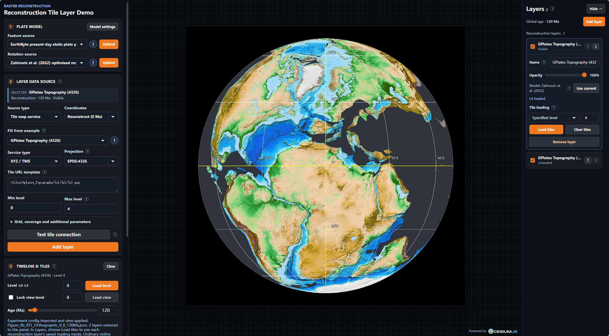

# 可重建瓦片图层（RTL）

[English](README.md) | 简体中文

[](.github/workflows/deploy-pages.yml)
[](package.json)
[](LICENSE)

在 Cesium 中对已发布 Web 瓦片服务进行浏览器端古地理重建。

本仓库包含论文 _Reconstructable Tile Layers for Geological-Time-Driven Digital
Earth: Browser-side Paleogeographic Reconstruction of Published Web Tile
Services without Republication_ 配套的 TypeScript 参考实现。

RTL 将地质年代和选定的刚性板块模型作为可执行的图层状态。它保留兼容的已发布
Web 瓦片服务作为影像源，将瓦片内容分配给多边形板块域，应用从 ROT 数据导出的
有限旋转，在 WebGL 中对边界瓦片进行掩膜，并在 Cesium 中渲染处理后的片段。
本实现重建的是已发布的可视图层，不会恢复源属性、拓扑、要素标识或数值栅格值。

三个可选栅格包分别读取数值源、适配标准 Cesium 影像，并在浏览器 Worker 中导出数值 COG。
Demo 接受 TIFF/GeoTIFF 栅格和作为普通矢量图层的 GeoJSON，尚未实现矢量重建。
NetCDF 仅通过栅格库显式的 `/netcdf` API 提供，不在 Demo 上传范围内。
详见[栅格操作](apps/reconstructable-tile-layer-demo/README.zh-CN.md#本地科学栅格)、
[GeoJSON 操作](apps/reconstructable-tile-layer-demo/README.zh-CN.md#本地-geojson-矢量)
及[参考数据验证说明](scripts/raster/README.md)。

## Demo

**在线演示：** [打开可重建瓦片图层 Demo](https://computational-planet.github.io/reconstructable-tile-layer/)。

**最简操作：** Demo 已提供默认数据源，无需加载案例配置即可使用。

1. 在 **Plate model** 中选择板块域和 ROT 来源；在 **Layer data source** 中选择 **Tile map service**，保留 **Reconstruct (0 Ma)**，点击 **Add layer**。
2. 在右侧 **Layers** 中选中该图层，将 **Tile loading** 设为 **Specified level**，选择层级后点击 **Load tiles**。左侧 **Timeline & tiles → Load level** 执行相同操作。
3. 调整 **Timeline & tiles** 中的 **Age (Ma)**。全部重建层随全局年代更新，各层仍使用自己绑定的板块模型。

局部细化使用左侧 **Load view** 或右侧 **Current view → Load tiles**。
不勾选 **Lock view level** 时自动选级，勾选后固定源层级。按视野加载会追加覆盖，
保留已有瓦片；普通影像和 GeoJSON 由 Cesium 加载，无需手动加载瓦片。

[`apps/reconstructable-tile-layer-demo`](apps/reconstructable-tile-layer-demo)
中的应用就是 `pnpm dev` 启动的项目 Demo。它：

- 基于 React、Vite、Cesium、统一 RTL 主包及三个可选栅格库；
- 通过 Turbo 启动核心库的 Rollup 监听构建；
- 支持替换影像服务、板块域数据和 ROT 模型；
- 通过可收起、独立滚动的 **Layers** 面板管理多个重建层、普通影像和 GeoJSON，固定图层可设置显示年代范围；
- 支持按区域或点查询 Macrostrat 图例，将重建位置反查至现代来源范围，并按颜色合并展示；
- 复现论文中的年代切换、源层级加载、视图感知细化、参考叠加、二维／透视／正射视图，以及实验 JSON 和截图导出流程。

工作区依赖已经安装、库已经构建时，在仓库根目录启动 Demo：

```sh
pnpm dev
```

首次克隆仓库，或者 `package.json`、`pnpm-lock.yaml` 发生变化后，先安装一次锁定
依赖再启动：

```sh
pnpm install --frozen-lockfile
pnpm build:packages
pnpm dev
```

Vite 会在终端输出本地地址。命令运行期间，核心库的代码变更会自动重新构建。
可选栅格库及其 Worker 修改后执行 `pnpm build:packages` 更新产物。



有关操作流程、导出行为和基准测试控制器，请参阅 Demo 的
[English README](apps/reconstructable-tile-layer-demo/README.md)
或[中文 README](apps/reconstructable-tile-layer-demo/README.zh-CN.md)。

## 研究材料

- 论文图件配置：[English](paper_configs/README.md) ·
  [简体中文](paper_configs/README.zh-CN.md)。
- 正文及补充材料使用的浏览器基准测试记录：
  [English](benchmark_records/README.md) ·
  [简体中文](benchmark_records/README.zh-CN.md)。

日常基准测试仍输出至被 git 忽略的 `output/`。论文实际使用并经过核对的三轮证据
记录单独保存在 `benchmark_records/`。

仓库开发使用 **Node.js 22**（与 Pages 构建一致）及 **pnpm 9.0.5**。
包清单声明 Node.js 18+，但仓库锁定的构建工具（包括 `rimraf@6`）要求 Node.js 20 或 22+。
Demo 运行需要支持 WebGL、Canvas、File/Blob 和 Worker 的浏览器；可选 COG 转换还使用 WASM。

## 功能特性

- 在不重新发布源服务的情况下，重建兼容的 WMS、WMTS、XYZ 和 URL 模板影像。
- 导入 GPML、GPMLZ、XML、自定义 JSON 板块域和 GPlates ROT 模型。
- 插值有限旋转并组合参考板块链。
- 使用惰性瓦片-板块四叉树索引板块域覆盖范围。
- 在 WebGL 中对边界瓦片进行掩膜，同时保留 MultiPolygon 分量和内环。
- 在年代变化时复用已处理影像，并根据当前 Cesium 视图自动选级或固定层级细化源瓦片。
- 通过逆旋转和四叉树筛选反查现代来源范围，无需加载影像；小范围查询可用 `clipToView` 保留查询尺度。

图层列表、固定图层年代范围、本地文件控件和 Macrostrat 图例客户端由 Demo 管理。
RTL 提供通用重建与空间查询 API；普通图层继续使用 Cesium 原生影像和矢量组件。

## 工作区

应用只需安装 RTL 主包及其 Cesium 对等依赖：

```sh
pnpm add reconstructable-tile-layer cesium
```

四个可复用核心模块位于 RTL 内部，保留独立构建和发布能力；RTL 自身产物已经包含
这些模块的实现和类型声明，无需额外安装独立模块包。
详见[公共入口说明](packages/reconstructable-tile-layer/README.zh-CN.md#公共入口与模块边界)。

```text
packages/
  reconstructable-tile-layer/
    src/                         图层 API 与流程编排
    modules/
      gplates-source/            文件读取与源记录
      finite-rotation/           旋转与参考板块链
      tile-plate-quadtree/       瓦片覆盖索引
      webgl-tile-processor/      GPU 影像处理
  rtl-raster-source/             可选数值栅格输入
  rtl-raster-imagery-provider/   可选 Cesium 适配器
  rtl-raster-converter/          可选 COG 导出
```

| 工作区                            | 源代码                                                                   | README                                                                                                                                                                               | 在 RTL 中的作用                                             |
| --------------------------------- | ------------------------------------------------------------------------ | ------------------------------------------------------------------------------------------------------------------------------------------------------------------------------------ | ----------------------------------------------------------- |
| `rtl-gplates-source`              | [目录](packages/reconstructable-tile-layer/modules/gplates-source)       | [English](packages/reconstructable-tile-layer/modules/gplates-source/README.md) · [简体中文](packages/reconstructable-tile-layer/modules/gplates-source/README.zh-CN.md)             | 读取 ROT/GPML/GPMLZ，提供不依赖 Cesium 的模型数据适配。     |
| `rtl-finite-rotation`             | [目录](packages/reconstructable-tile-layer/modules/finite-rotation)      | [English](packages/reconstructable-tile-layer/modules/finite-rotation/README.md) · [简体中文](packages/reconstructable-tile-layer/modules/finite-rotation/README.zh-CN.md)           | 消费 ROT 记录、插值单位四元数并组合板块参考链。             |
| `rtl-tile-plate-quadtree`         | [目录](packages/reconstructable-tile-layer/modules/tile-plate-quadtree)  | [English](packages/reconstructable-tile-layer/modules/tile-plate-quadtree/README.md) · [简体中文](packages/reconstructable-tile-layer/modules/tile-plate-quadtree/README.zh-CN.md)   | 构建惰性板块域瓦片索引，并生成完整或经过裁剪的源瓦片条目。  |
| `rtl-webgl-tile-processor`        | [目录](packages/reconstructable-tile-layer/modules/webgl-tile-processor) | [English](packages/reconstructable-tile-layer/modules/webgl-tile-processor/README.md) · [简体中文](packages/reconstructable-tile-layer/modules/webgl-tile-processor/README.zh-CN.md) | 请求源影像、重映射 WebMercator 纹理并生成 GPU 掩膜图像。    |
| `reconstructable-tile-layer`      | [目录](packages/reconstructable-tile-layer)                              | [English](packages/reconstructable-tile-layer/README.md) · [简体中文](packages/reconstructable-tile-layer/README.zh-CN.md)                                                           | 实现 RTL 对象、任务调度、保留记录、年代更新和 Cesium 图元。 |
| `reconstructable-tile-layer-demo` | [目录](apps/reconstructable-tile-layer-demo)                             | [English](apps/reconstructable-tile-layer-demo/README.md) · [简体中文](apps/reconstructable-tile-layer-demo/README.zh-CN.md)                                                         | 使用可替换的服务、模型、年代和视图演示论文工作流。          |

每个工作区的 README 都说明了其方法作用、输入约定、用法和保留资源的生命周期。

| 可选包                                                              | 职责                                                          | 与主包的关系                                                |
| ------------------------------------------------------------------- | ------------------------------------------------------------- | ----------------------------------------------------------- |
| [rtl-raster-source](packages/rtl-raster-source)                     | 本地数值窗口、CRS/网格元数据、显式 `/netcdf` 子入口的 CF 选片 | 无 Cesium/React/重建依赖，可独立用于科学数据处理            |
| [rtl-raster-imagery-provider](packages/rtl-raster-imagery-provider) | 将数值源变成单波段/RGB/NoData 影像，控制缓存                  | Cesium peer；独立 Viewer 或现有 RTL `provider` 接口均可使用 |
| [rtl-raster-converter](packages/rtl-raster-converter)               | TIFF 或已选二维切片 → COG 与溯源 JSON；GDAL Worker 按需启动   | 无 Cesium/React；由宿主提供引擎静态资源；直接显示无需转换   |

主包不强依赖这些引擎。本地 TIFF 的数据链路是 `rtl-raster-source` →
`rtl-raster-imagery-provider` → Cesium 原生 `ImageryLayer` 或 RTL 的 `provider` 输入。
`rtl-raster-converter` 是独立的可选导出步骤，显示不要求预先转换。

现代坐标源参与重建时需要匹配的板块模型；已有古坐标快照使用普通影像图层按年代显示，不再旋转。
此接入不提供数值点查询；Macrostrat 点选图例查询的是服务元数据，不是栅格数值。

## 方法与代码映射

| 论文术语或阶段   | 推荐代码 API                                    | 软件包                                                                        |
| ---------------- | ----------------------------------------------- | ----------------------------------------------------------------------------- |
| 可重建瓦片图层   | `ReconstructableTileLayer`                      | `reconstructable-tile-layer`                                                  |
| 服务注册         | `provider`、`setImageryProvider`                | `reconstructable-tile-layer`                                                  |
| 板块域要素       | `PlateDomainFeature`、`PlateDomainSourceConfig` | `reconstructable-tile-layer`                                                  |
| `TileClipArea`   | 地理坐标和瓦片局部坐标下的多边形掩膜            | `reconstructable-tile-layer/quadtree`、`reconstructable-tile-layer/processor` |
| 有限旋转插值器   | `FiniteRotationInterpolator`                    | `reconstructable-tile-layer/rotation`                                         |
| 瓦片-板块四叉树  | `PlateDomainTileQuadtree`                       | `reconstructable-tile-layer/quadtree`                                         |
| 复合瓦片任务     | `CompositeTileTask`                             | `reconstructable-tile-layer`                                                  |
| 已处理瓦片记录   | `ProcessedTileRecord`                           | `reconstructable-tile-layer`                                                  |
| WebGL 处理器     | `WebGLTileProcessor`                            | `reconstructable-tile-layer/processor`                                        |
| 年代感知更新     | `setReconstructionAge`                          | `reconstructable-tile-layer`                                                  |
| 视图感知细化     | `refineTilesForView`                            | `reconstructable-tile-layer`                                                  |
| 现代来源范围查询 | `querySourceRegions`                            | `reconstructable-tile-layer`                                                  |

这些名称对应论文方法部分的各个阶段：服务注册；板块域与旋转准备；瓦片-板块索引与
任务调度；以及 GPU 掩膜和 Cesium 渲染。

## 最小 RTL 工作流

```ts
import { ReconstructableTileLayer, WebGLTileProcessor } from "reconstructable-tile-layer";

const webglProcessor = new WebGLTileProcessor({
  outputType: "canvas",
  slotCount: 4,
});

const rtl = await ReconstructableTileLayer.create({
  provider: imageryProvider,
  processor: webglProcessor,
  featureSource: {
    url: "/models/static-polygons.gpmlz",
    polygonRenderIntent: "all-polygons-area",
  },
  rotationSources: ["/models/rotations.rot"],
  initialAge: 0,
  anchorPlateId: "0",
  referenceEllipsoid: viewer.scene.globe.ellipsoid,
});

rtl.bindSceneModeSync(viewer);
await rtl.loadSourceTilesAtLevel(viewer, 4);
await rtl.setReconstructionAge(120);
await rtl.refineTilesForView(viewer); // 自动选择源层级
// 改用 rtl.refineTilesForView(viewer, { level: 4 }) 可固定在 L4 查询当前视野。

rtl.destroy(viewer);
webglProcessor.destroy();
```

影像提供器、WebGL 处理器和 Cesium viewer 均由调用方所有。Provider 与 viewer 应使用
相同椭球，销毁时先销毁 RTL，再销毁这些依赖。加载会保留已处理瓦片，直到主动清理；
层级选择、来源范围查询与生命周期详见[图层 API](packages/reconstructable-tile-layer/README.zh-CN.md#加载和可执行年代状态)。

## 输入与方法范围

RTL 接受使用地理坐标 EPSG:4326 或 WebMercator 瓦片方案的 Cesium 影像提供器。
板块域数据源可以是 GPML、GPMLZ、XML、自定义 JSON 要素数组或浏览器上传 URL。
这里的模型 JSON 不是 GeoJSON；有限旋转从 GPlates ROT 文本中读取。
Demo 的 GeoJSON 上传入口仅显示普通矢量，不作为板块域输入，也不执行矢量重建。

本实现在 `TileClipArea` 中保留 MultiPolygon 的各个部分和内环。一般的跨反子午线
环必须预先编码为在日期变更线处分离的多边形分量，这与论文所述的当前方法限制一致。

## 开发命令

| 命令                  | 用途                                       |
| --------------------- | ------------------------------------------ |
| `pnpm dev`            | 启动 RTL、核心模块的监听构建和 Vite demo。 |
| `pnpm build`          | 构建全部库，然后生成 demo 的生产构建。     |
| `pnpm build:packages` | 仅构建工作区内的可发布库。                 |
| `pnpm check`          | 运行格式、lint、构建、类型检查和测试。     |
| `pnpm test`           | 运行工作区库和 Demo 的测试。               |
| `pnpm clean`          | 删除工作区构建输出和 Turbo 缓存。          |

共享 Rollup 配置为 RTL 和核心模块生成 ESM、CommonJS 和 TypeScript 声明输出；
Raster 扩展使用 ESM/Worker 构建。Cesium 保持为对等依赖，不会打包进这些软件包。

`pnpm --filter reconstructable-tile-layer build` 可单独构建 RTL，直接读取内嵌模块源码。
例如 `pnpm --filter rtl-finite-rotation build` 可独立构建旋转包。开发依赖中的 workspace
关系用于构建顺序和缓存失效；发布后的运行时依赖不含四个核心包名。根入口与子入口
共享 Rollup chunks，RTL 的监听构建也会追踪内嵌源码的变更。

如果只需启动 demo，请先确保各个库已经构建，再执行：

```sh
pnpm --filter reconstructable-tile-layer-demo dev
```

## 验证

```sh
pnpm check
```

该命令会运行格式检查、lint、软件包和演示程序构建、TypeScript 检查及库和 Demo 回归测试，
包括论文配置的导入／导出检查。
构建后执行 `pnpm test:distribution`，会在项目外的临时目录安装真实 tarball，验证仅安装
RTL、ESM/CJS 入口、类型声明闭合、独立处理器注入、Raster 扩展导入，以及不安装 Cesium
时的独立 GPlates 读取。该检查不启动服务器，证据保存在临时目录。使用已有离线缓存时，
设置 `RTL_PNPM_STORE` 并运行 `pnpm test:distribution --offline`。

## 引用

在研究中使用本实现时，请引用上述论文。作者、期刊或会议、DOI 和最终书目信息应以
论文正式发表版本为准。

## 许可证

源代码采用 ISC 许可证。仓库内附的地质和影像资源继续适用其原始提供方注明的引用
和使用条款。
