# Reconstructable Tile Layer Demo User Guide

English | [简体中文](USER_GUIDE.zh-CN.md)

The interface is in English. Button and option names below match the labels in the Demo. Open a deployed Demo or follow the [startup instructions](../README.md#quick-start) to run it locally. The first two sections take you directly through a reconstruction and a paper case.

## Quick navigation

### 1. Quick start: load and reconstruct an RTL layer

1. Keep all default settings and click **Add layer** in **Layer data source** on the left.
2. Wait until **Load level** in **Timeline & tiles** on the left is enabled, then click it. Alternatively, wait until **Load tiles** in the **Layers** panel on the right is enabled and click it (L4 by default).
3. Wait for the tiles to appear on the globe, then adjust the **Age (Ma)** timeline in **Timeline & tiles** on the left to view the reconstruction.

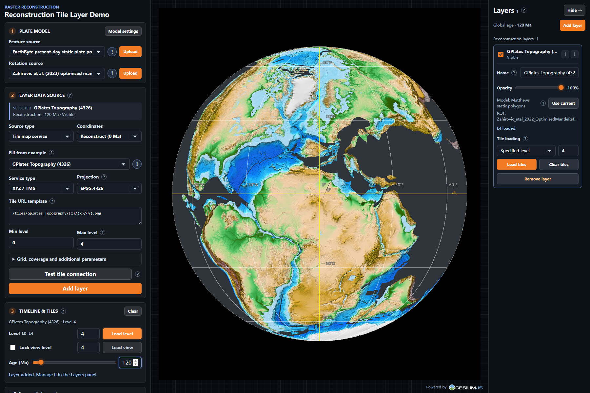

### 2. Load a paper case

The repository's [`paper_configs/`](../../../paper_configs/README.md) directory contains the JSON configurations used for paper figures. For example, `paper_configs/case/Figure_5c_120Ma_L4.json` sets up a Macrostrat map at 120 Ma.

1. Scroll down the left panel to **Experiment**, click **Import** and select that JSON file.
2. The age, view and layer configuration are restored. If the right panel is hidden, open it with **Layers** at the top right.
3. Select **Macrostrat Carto — Zahirovic et al. (2022)** in **Layers**. Check that **Tile loading** is **Specified level** and the level is `4`, then click **Load tiles**.
4. Wait for the layer to show **L4 loaded** to view the case. Macrostrat tiles are retrieved over the network.

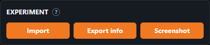

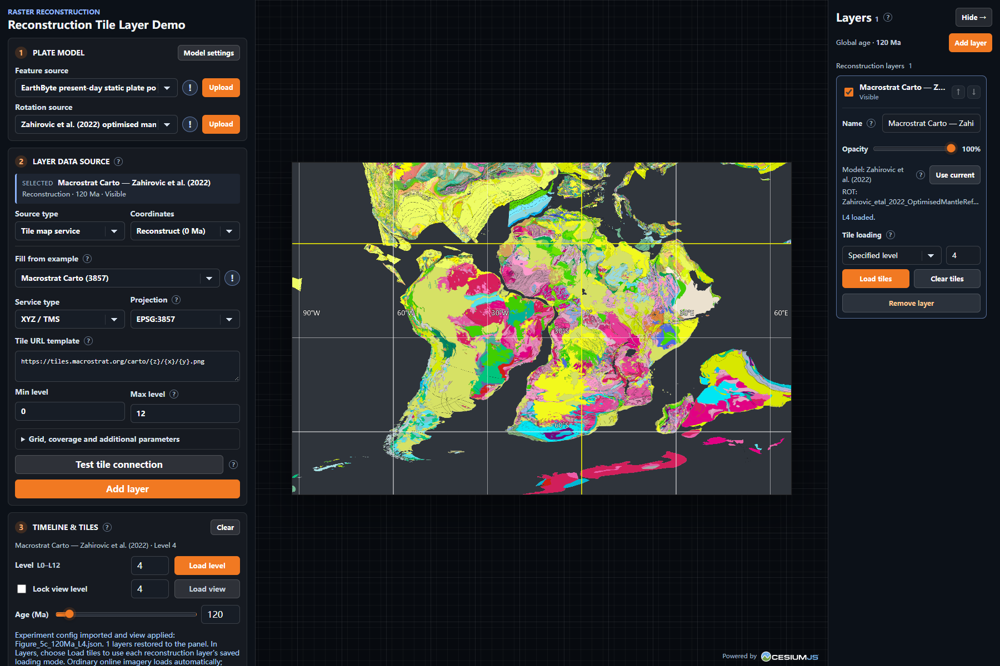

Import replaces the current layer list and restores the configuration rather than loaded tiles. To keep the current settings, click **Export info** first. See the [case guide](../../../paper_configs/case/README.md) and [evaluation configuration guide](../../../paper_configs/evaluation/README.md) for the other files and their loading sequences. For figures that add local L8 coverage over L4, perform both loading steps in the same session.

## 3. Interface and basic controls

- The left panel follows the workflow: **Plate model**, **Layer data source**, **Timeline & tiles**, followed by reference, camera, rendering and experiment tools. It scrolls independently.
- **Layers** on the right manages the layers you have added. Click **Hide →** to collapse it and **Layers** at the top right to reopen it; the layer list also scrolls independently.
- Click **?** beside a control for help; **!** beside an example shows its citation. Click elsewhere or press `Esc` to close the explanation.
- Status text reports operations, results and items that need attention. Editing the source form on the left prepares the next addition; existing layers retain their own settings.

## 4. Plate model: choose a reconstruction model

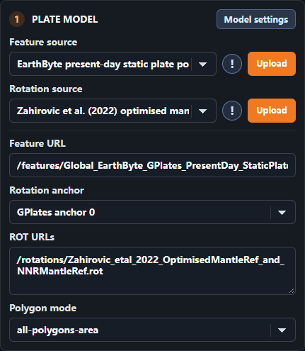

**Feature source** supplies plate-domain polygons and **Rotation source** supplies finite rotations. Choose matching presets or click the respective **Upload** buttons to use local files: plate domains accept GPML, GPMLZ, XML or compatible JSON; rotations accept one or more ROT/TXT files. Matching plate-domain and rotation models keeps their reference frames consistent.

Click **Model settings** for these options:

| Option              | Purpose                                                                                                                     |
| ------------------- | --------------------------------------------------------------------------------------------------------------------------- |
| **Feature URL**     | Enter a plate-domain file address; after uploading, **Use URL** returns to address entry.                                   |
| **Rotation anchor** | Use the default GPlates anchor 0, automatic recursion, or **Custom plate ID** with an anchor plate number.                  |
| **ROT URLs**        | Enter one rotation-file address per line; after uploading, **Use URLs** returns to address entry.                           |
| **Polygon mode**    | Choose `classified` or `all-polygons-area` to control how plate-domain polygons are interpreted; the latter is the default. |

Adding a reconstruction layer binds the current plate domains, ROT files and anchor to that layer. To update an existing layer, choose the new model on the left, select the layer on the right, click **Use current**, and reload its tiles. The layer card shows the model name and ROT filenames; its model **?** displays the complete list.

## 5. Layer data source: add data

Choose a **Source type**, complete its form and click **Add layer** to create a new layer. Each addition keeps the layers already present.

### 5.1 Online tile services

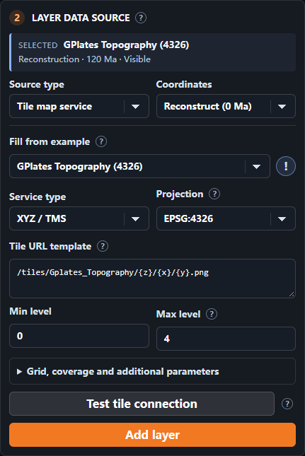

1. Choose **Tile map service**. Under **Coordinates**, select **Reconstruct (0 Ma)** to move present-day imagery with the plates, or **Fixed coordinates** to display ordinary imagery.
2. Choose an example under **Fill from example**, or select **Your connection (blank form)** to enter your own service. Example fields are editable; **Reset example** restores their original values.
3. Select the service's **Service type** and **Projection**, then enter its address and required fields:
   - **XYZ / TMS**: use a tile URL template such as `https://example.org/{z}/{x}/{y}.png`; TMS can use `{reverseY}`.
   - **WMS**: enter the service address, **Layers**, version, request CRS, styles and image format.
   - **WMTS**: enter the service address, **Layer**, **Tile matrix set ID**, style and image format. KVP endpoints and REST templates are supported.
4. Enter the service's supported **Min level / Max level**. Expand **Grid, coverage and additional parameters** for the L0 grid, tile dimensions, coverage, subdomains, WMTS matrix labels and extra parameters, as well as the connection name and attribution.
5. Click **Test tile connection** to check a sample tile, then click **Add layer**. Load reconstruction tiles as in section 1; ordinary imagery loads automatically with the map view.

Match the projection and tile grid to the provider's settings. Online services need to allow browser access through CORS. A service's own time parameters stay at the values entered in the form; the Demo timeline controls geological reconstruction age.

### 5.2 Local TIFF / GeoTIFF

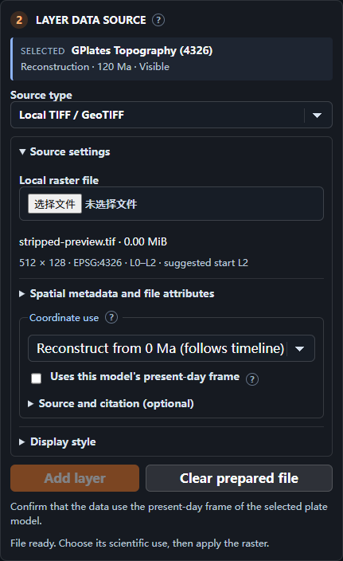

1. Choose **Local TIFF / GeoTIFF**, expand **Source settings** and select a georeferenced, north-up EPSG:4326 or EPSG:3857 TIFF. The Demo shows its dimensions, coordinate system and suggested tile level; the browser reads the file locally.
2. Choose a **Coordinate use**:
   - **Reconstruct from 0 Ma (follows timeline)**: for present-day rasters that should move with the plates. Confirm **Uses this model's present-day frame**, add the layer and load its reconstruction tiles.
   - **Reference / unknown coordinate age**: display the file coordinates as ordinary imagery.
   - **Paleo snapshot (visible at one age)**: enter the snapshot's **Display age** and age source; its visible age range can be edited in the right panel after adding it.
3. Expand **Spatial metadata and file attributes** to inspect bounds, bands, NoData and overviews. **View source bounds** moves the camera to the stored extent.
4. Expand **Display style** to choose single-band or RGB bands, an estimated or manual colour range, a colour ramp and additional display-only NoData values. **Source and citation** records the dataset source and reference frame.
5. Click **Add layer**. **Clear prepared file** clears the file prepared in the form; layers already added remain available.

Display styles control the map appearance while retaining the original numeric values. L2, L3 and so on describe the tile subdivision used for display; a higher level divides the coverage more finely.

### 5.3 Local GeoJSON

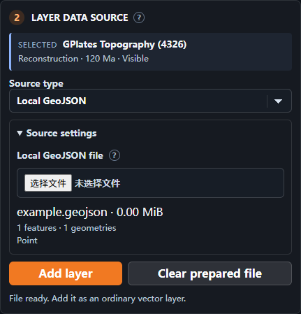

Choose **Local GeoJSON**, select a `.geojson` or GeoJSON `.json` file in **Source settings**, review the feature and geometry summary, and click **Add layer**. Points, lines, polygons and their Multi types use WGS84 longitude and latitude; optional height is retained.

GeoJSON appears in the **Ordinary vectors** group on the right. Set its name, opacity and visible age range there, or click **Zoom to layer**. It is displayed as an ordinary vector layer in its stored coordinates, with the timeline controlling visibility.

## 6. Timeline & tiles: age and tile loading

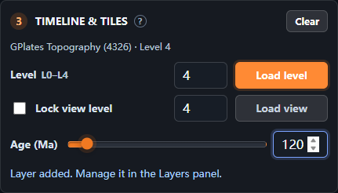

First select a reconstruction layer on the right. The left panel shows its name, loading mode and available levels:

- **Level → Load level** loads the layer's relevant tiles at the specified level, useful for establishing overall coverage.
- **Lock view level → Load view** loads for the current view. Leave the box unchecked for automatic level selection, or check it and enter an integer level.
- **Clear** removes the selected reconstruction layer's loaded tiles while keeping the layer.
- **Age (Ma)** sets the global geological age. Ma means millions of years ago. All reconstruction layers follow it using their own bound plate models; fixed-coordinate layers display according to their visible age ranges.

You can use **Load view** repeatedly to add coverage while retaining tiles already loaded. To start with a clean coverage area, click **Clear** first; this also helps when retained levels overlap. A whole-layer **Load level** replaces the relevant coverage when switching loading modes or specified levels.

## 7. Layers: manage the layer stack

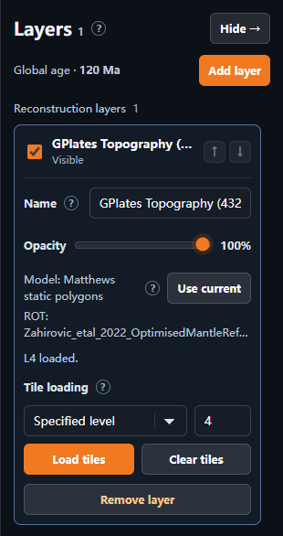

The right panel groups layers under **Reconstruction layers**, **Ordinary imagery** and **Ordinary vectors**. Click a layer name to expand its controls and use its checkbox to show or hide it. For reconstruction layers and ordinary imagery, the arrows change order within each group. Reconstruction layers draw above ordinary imagery; ordinary vector overlap follows geometry depth and transparency.

After selecting a layer, use:

| Option                        | Purpose                                                                                                                            |
| ----------------------------- | ---------------------------------------------------------------------------------------------------------------------------------- |
| **Name / Opacity**            | Edit the name and opacity; the name is applied when the field loses focus.                                                         |
| **Model / ROT / Use current** | Inspect a reconstruction layer's model and rotation files, or replace them with the current model on the left and reload.          |
| **Tile loading**              | Choose **Specified level** or **Current view**, set the level and click **Load tiles**; **Clear tiles** clears that layer's tiles. |
| **Visible ages (Ma)**         | For fixed layers, select **All ages**, or enter **Youngest** and **Oldest** and click **Apply**. Both endpoints are included.      |
| **Zoom to layer**             | Move the view to an ordinary vector layer.                                                                                         |
| **Remove layer**              | Remove the selected layer.                                                                                                         |

A fixed layer's visibility follows both its checkbox and its age range. For example, with a range of 100–150 Ma, the checked layer appears when the timeline is within that interval.

## 8. Reference & Legend: outlines and legends

Expand **Reference & Legend**, then open the tool you want.

### 8.1 GPlates reference

Choose a preset outline and colour in **GPlates reference** to overlay it for visual comparison. Select **Off** to hide it. Choosing a reference for the current age and plate model makes comparison easier.

### 8.2 Macrostrat legend

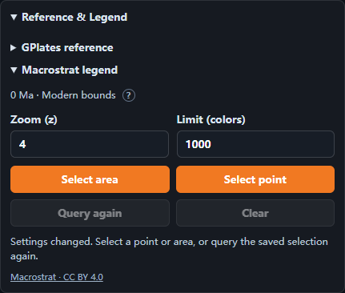

1. Add a Macrostrat Carto layer, expand **Macrostrat legend**, and set **Zoom (z)** to the tile level you want to query. The default is `4`.
2. At a nonzero age, choose the corresponding Macrostrat reconstruction layer under **Reconstruction layer**.
3. Click **Select area** and drag a complete rectangle on the globe, or click **Select point** and click a point on the globe. Press `Esc` or **Cancel** to end selection.
4. Legend entries appear as requests finish. Expand a colour entry to inspect names, ages, lithology, descriptions and original Legend IDs. **Query area / Query point** shows the selection and modern query bounds.
5. **Query again** repeats the current selection; **Clear** removes the selection and results.

The example below shows an actual point query at 0 Ma and z8, with its entry expanded.

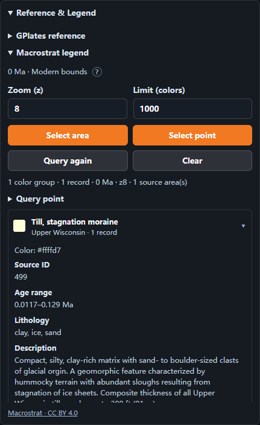

At 0 Ma the selected modern bounds are queried directly. At other ages, the selected layer's plate model maps the selection back to the modern frame and filters relevant areas at the legend level. A point uses a small area extending 0.0001° in each direction. Results are merged by ID and records with the same colour are grouped together. **Limit (colors)** defaults to `1000` colour groups; if the limit is exceeded, narrow the selection and query again. Results already received remain visible when some requests fail, and **Query again** can retry them. Query bounds approximate the area used for retrieval, so nearby units can also appear.

## 9. Camera & Output: view and output size

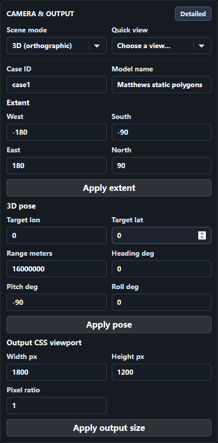

**Scene mode** offers **2D rectangular**, **3D (perspective)** and **3D (orthographic)**. **Quick view** centres the view on the prime meridian/equator intersection, antimeridian, South Pole or North Pole.

Click **Detailed** for additional settings:

- **Case ID / Model name**: identify the experiment output.
- **Extent**: enter west, south, east and north bounds, then click **Apply extent**.
- **3D pose**: set target longitude and latitude, range and orientation, then click **Apply pose**.
- **Output CSS viewport**: set width, height and **Pixel ratio**, then click **Apply output size**. The accompanying exported JSON records the actual canvas pixel dimensions.

## 10. Rendering: display settings

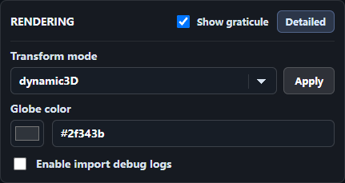

**Show graticule** controls the latitude/longitude grid and labels. Click **Detailed** to set the globe base colour, enable import debug logs, or choose a transform mode and click **Apply**. `dynamic3D` supports dynamic 3D updates; `bakedInstance` supports instance transformations in 2D and other scene modes.

## 11. Experiment and Runtime statistics

- **Import** restores layer configuration, age and view from an experiment JSON. Load the required reconstruction tiles as in section 2.
- **Export info** downloads a JSON file with the current configuration and runtime information for recording or later import.
- **Screenshot** downloads the map PNG and matching JSON. The screenshot shows the map; use a browser or system screenshot to record panel controls or the legend list.
- **Runtime statistics** expands to show runtime statistics.

Experiment JSON stores layer settings and local-file descriptions. After reimporting, choose **Prepare local file** on the TIFF or GeoJSON layer on the right, reselect the file, and click **Restore selected layer** on the left; a reconstruction TIFF also needs **Uses this model's present-day frame** confirmed. If that layer uses local plate-domain or ROT files, click **Prepare local file** first, upload the model files again on the left and click **Use current** for the layer, then finish selecting and restoring the TIFF. For an online reconstruction layer, upload its model files and click **Use current**, then load its tiles. Macrostrat legend selections and results can be queried again in a new session.
