# Reconstructable Tile Layer Demo 用户手册

[English](USER_GUIDE.md) | 简体中文

界面使用英文。本手册保留按钮和选项的英文名称，方便与界面逐一对应。可打开已部署的 Demo，或参考[启动说明](../README.zh-CN.md#快速开始)在本地运行。下面两节可以直接带你完成一次重建或载入论文案例。

## 快速导航

### 1. 最小操作：加载并重建一个 RTL 图层

1. 保留全部默认配置，在左侧 **Layer data source** 栏点击 **Add layer**。
2. 等待左侧 **Timeline & tiles** 栏的 **Load level** 按钮亮起后点击；也可以等待右侧 **Layers** 面板的 **Load tiles** 按钮亮起后点击（默认 L4）。
3. 等待地球上出现瓦片，然后在左侧 **Timeline & tiles** 栏调整 **Age (Ma)** 时间轴，查看重建结果。

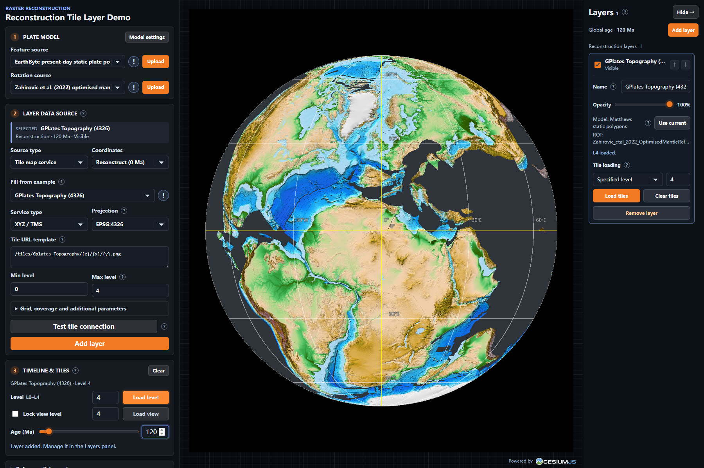

### 2. 加载论文实验案例

仓库的 [`paper_configs/`](../../../paper_configs/README.zh-CN.md) 提供论文图件使用的 JSON 配置。例如，`paper_configs/case/Figure_5c_120Ma_L4.json` 对应 120 Ma 的 Macrostrat 地图。

1. 在左侧面板向下滚动至 **Experiment**，点击 **Import**，选择该 JSON 文件。
2. 导入后，年代、视角和图层配置会恢复。若右侧面板已隐藏，点击右上角 **Layers** 将其打开。
3. 在 **Layers** 中选中 **Macrostrat Carto — Zahirovic et al. (2022)**。确认 **Tile loading** 为 **Specified level**、层级为 `4`，点击 **Load tiles**。
4. 等待图层显示 **L4 loaded**，即可查看案例结果。Macrostrat 瓦片通过网络读取。

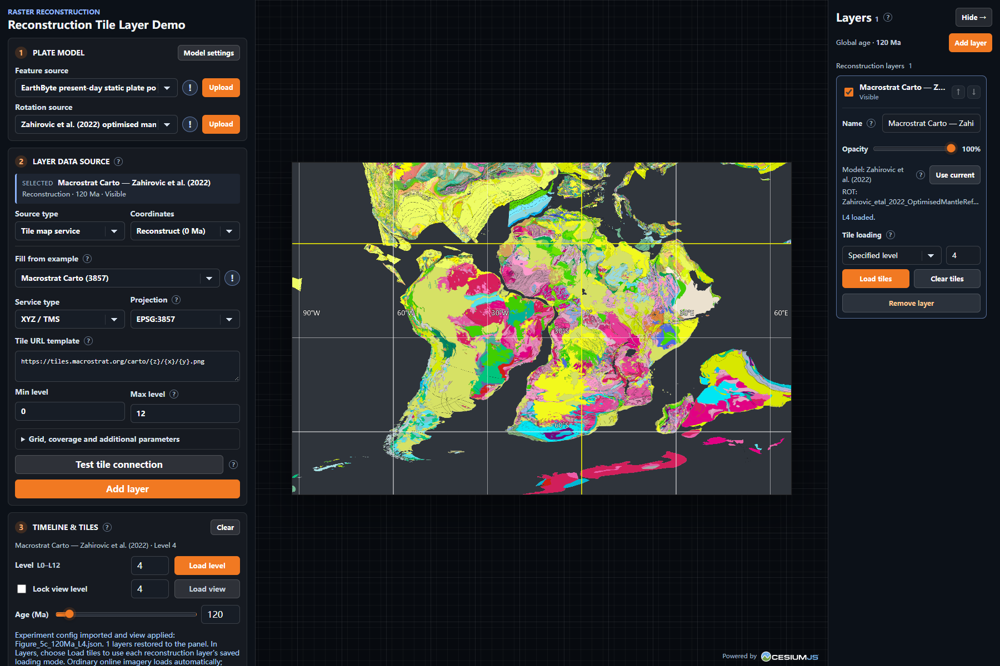

导入会替换当前图层列表，并恢复配置而非已加载的瓦片。需要保留当前设置时，可先点击 **Export info**。其他案例及其加载顺序见[案例说明](../../../paper_configs/case/README.zh-CN.md)和[评估配置说明](../../../paper_configs/evaluation/README.zh-CN.md)；涉及先加载 L4、再叠加局部 L8 的图件，应在同一次会话中依次执行两个加载步骤。

## 3. 界面与基本操作

- 左侧面板按流程排列：**Plate model**、**Layer data source**、**Timeline & tiles**，以及后续的参考、相机、渲染和实验工具。面板可独立滚动。
- 右侧 **Layers** 管理已添加的图层。点击 **Hide →** 收起，点击右上角 **Layers** 重新打开；图层列表也可以独立滚动。
- 点击选项旁的 **?** 查看说明；示例来源旁的 **!** 显示引用信息。点击其他位置或按 `Esc` 可关闭说明。
- 状态文字显示正在执行的操作、加载结果和需要处理的信息。修改左侧来源表单用于准备下一次添加，已有图层保留各自的设置。

## 4. Plate model：选择板块模型

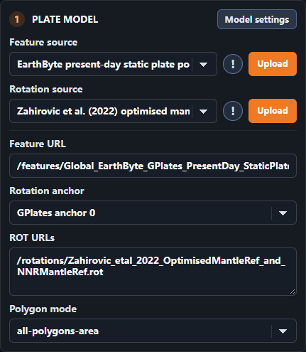

**Feature source** 提供板块域多边形，**Rotation source** 提供有限旋转。可直接选择配套预设，也可点击各自的 **Upload** 选择本地文件：板块域支持 GPML、GPMLZ、XML 或兼容 JSON；旋转源支持一个或多个 ROT/TXT 文件。使用配套的板块域与旋转模型，能够保持两类数据的参考框架一致。

点击 **Model settings** 可设置：

| 选项                | 用途                                                                                   |
| ------------------- | -------------------------------------------------------------------------------------- |
| **Feature URL**     | 输入板块域文件地址；上传文件后可通过 **Use URL** 切换回地址。                          |
| **Rotation anchor** | 使用默认的 GPlates anchor 0、自动递归，或选择 **Custom plate ID** 并输入锚定板块编号。 |
| **ROT URLs**        | 输入旋转文件地址，每行一个；上传文件后可通过 **Use URLs** 切换回地址。                 |
| **Polygon mode**    | 选择 `classified` 或 `all-polygons-area`，控制板块域多边形的解释方式；默认使用后者。   |

添加重建图层时，当前板块域、ROT 和锚点会绑定到该层。要更新已有图层，先在左侧选择新模型，再在右侧选中该层并点击 **Use current**，然后重新加载瓦片。图层卡片会显示模型名称和 ROT 文件名，点击模型旁的 **?** 可查看完整列表。

## 5. Layer data source：添加数据

选择 **Source type** 后填写对应表单，点击 **Add layer** 创建新图层。每次添加都会保留已有图层。

### 5.1 在线瓦片服务

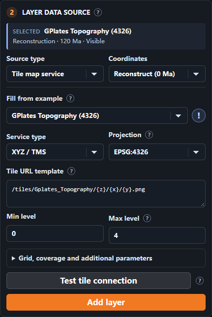

1. 选择 **Tile map service**。在 **Coordinates** 中选择 **Reconstruct (0 Ma)** 使现代图像随板块重建，或选择 **Fixed coordinates** 将其作为普通影像显示。
2. 在 **Fill from example** 中选择示例填充表单，或者选择 **Your connection (blank form)** 输入自己的服务。示例字段也可以编辑；**Reset example** 可恢复示例值。
3. 根据服务选择 **Service type** 和 **Projection**，填写地址及该服务需要的字段：
   - **XYZ / TMS**：使用瓦片地址模板，例如 `https://example.org/{z}/{x}/{y}.png`；TMS 可使用 `{reverseY}`。
   - **WMS**：填写服务地址、**Layers**、版本、请求 CRS、样式和图像格式。
   - **WMTS**：填写服务地址、**Layer**、**Tile matrix set ID**、样式和图像格式；可使用 KVP 地址或 REST 模板。
4. 在 **Min level / Max level** 中填写服务支持的范围。展开 **Grid, coverage and additional parameters** 可设置 L0 行列数、瓦片尺寸、覆盖范围、子域、WMTS 矩阵标签和附加参数，以及连接名称与署名。
5. 点击 **Test tile connection** 检查一张示例瓦片，再点击 **Add layer**。重建图层添加后按第 1 节加载瓦片；普通影像随地图视野自动加载。

投影、瓦片网格和服务提供方的设置应相匹配；在线服务需要允许浏览器跨域访问（CORS）。服务本身的时间参数按表单设置保持固定，地质年代由 Demo 的时间轴控制。

### 5.2 本地 TIFF / GeoTIFF

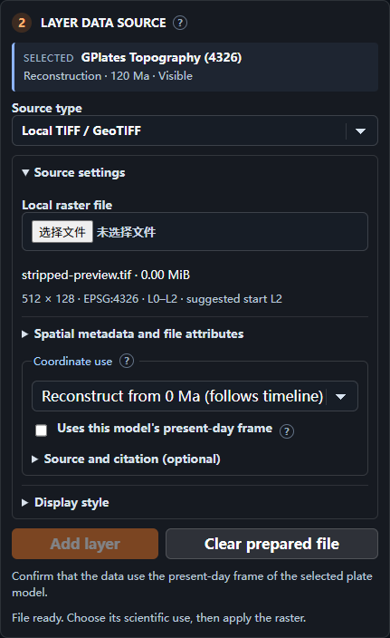

1. 选择 **Local TIFF / GeoTIFF**，展开 **Source settings** 并选择带地理参考、北向上的 EPSG:4326 或 EPSG:3857 TIFF 文件。Demo 显示文件尺寸、坐标系和建议的瓦片层级；文件在浏览器中读取。
2. 在 **Coordinate use** 中选择数据用途：
   - **Reconstruct from 0 Ma (follows timeline)**：用于现代坐标下、需要随板块运动的栅格。确认 **Uses this model's present-day frame**，添加后加载重建瓦片。
   - **Reference / unknown coordinate age**：按文件坐标作为普通影像显示。
   - **Paleo snapshot (visible at one age)**：输入该快照的 **Display age** 和年代来源；添加后可在右侧修改可见年代范围。
3. 可展开 **Spatial metadata and file attributes** 查看范围、波段、NoData 和概览信息；**View source bounds** 将视角移到原始范围。
4. 可展开 **Display style** 选择单波段或 RGB 波段、估算或手动颜色范围、色带和额外的显示用 NoData 值。**Source and citation** 可记录数据来源和参考框架。
5. 点击 **Add layer**。**Clear prepared file** 清除当前表单中的待添加文件，已添加的图层继续保留。

显示样式调整的是地图呈现，原始数值保持不变。L2、L3 等表示用于显示的瓦片划分；选择更高层级可以细分覆盖范围。

### 5.3 本地 GeoJSON

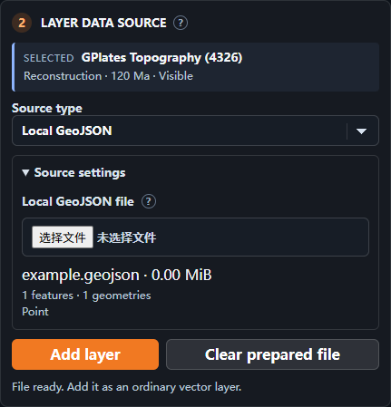

选择 **Local GeoJSON**，在 **Source settings** 选择 `.geojson` 或 GeoJSON 格式的 `.json` 文件，确认要素和几何类型摘要后点击 **Add layer**。点、线、面及其 Multi 类型使用 WGS84 经度、纬度坐标；可选高度也会保留。

GeoJSON 显示在右侧 **Ordinary vectors** 组中。可设置名称、透明度和显示年代范围，也可以点击 **Zoom to layer** 定位。它以普通矢量图层的坐标显示，时间轴用于控制其可见性。

## 6. Timeline & tiles：年代和瓦片

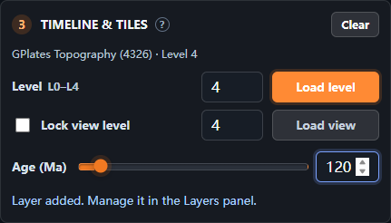

先在右侧选择一个重建图层。左侧显示该层的名称、加载模式和可用层级：

- **Level → Load level**：加载该层在指定层级的相关瓦片，适合建立整体覆盖。
- **Lock view level → Load view**：按当前视野加载。未勾选时自动选择层级；勾选后按输入的整数层级加载。
- **Clear**：清除所选重建层已加载的瓦片，图层本身仍保留。
- **Age (Ma)**：设置全局地质年代，Ma 表示百万年前。所有重建图层使用各自绑定的板块模型跟随年代变化；固定坐标图层根据其可见年代范围显示。

**Load view** 可重复使用，并保留之前加载的覆盖。若希望从干净的覆盖范围重新开始，可先点击 **Clear**；不同层级重叠时也可这样整理画面。整体 **Load level** 在切换加载模式或指定层级时会替换相应覆盖。

## 7. Layers：管理图层

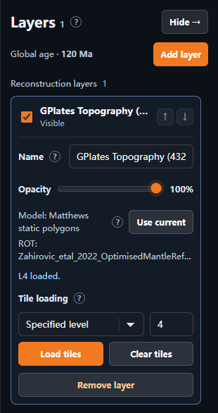

右侧按 **Reconstruction layers**、**Ordinary imagery** 和 **Ordinary vectors** 分组。点击图层名称展开编辑项，勾选框控制显示；对于重建图层和普通影像，可用箭头在各自组内调整上下顺序。重建图层绘制在普通影像之上；普通矢量的重叠由几何深度和透明度决定。

选中图层后可使用：

| 选项                          | 用途                                                                                                               |
| ----------------------------- | ------------------------------------------------------------------------------------------------------------------ |
| **Name / Opacity**            | 修改名称和透明度；名称在离开输入框时应用。                                                                         |
| **Model / ROT / Use current** | 查看重建层所用模型和旋转文件，或用左侧当前模型替换并重新加载。                                                     |
| **Tile loading**              | 在 **Specified level** 和 **Current view** 之间选择，填写层级后点击 **Load tiles**；**Clear tiles** 清除该层瓦片。 |
| **Visible ages (Ma)**         | 对固定图层选择 **All ages**，或输入 **Youngest** 和 **Oldest** 后点击 **Apply**。两个端点均包含在范围内。          |
| **Zoom to layer**             | 将视角移到普通矢量图层。                                                                                           |
| **Remove layer**              | 移除当前图层。                                                                                                     |

固定图层的可见性同时受勾选状态和年代范围控制。例如设置 100–150 Ma 后，时间轴处于这一范围内时图层才会按勾选状态显示。

## 8. Reference & Legend：参考轮廓和图例

展开 **Reference & Legend**，再展开所需工具。

### 8.1 GPlates reference

在 **GPlates reference** 中选择预置的参考轮廓和颜色，即可叠加到地图上进行目视比较。选择 **Off** 可关闭轮廓。为便于比较，可选择与当前年代和板块模型对应的参考数据。

### 8.2 Macrostrat legend

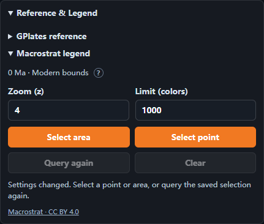

1. 添加 Macrostrat Carto 图层，展开 **Macrostrat legend**，将 **Zoom (z)** 设为希望查询的瓦片层级，默认是 `4`。
2. 在非零年代，从 **Reconstruction layer** 选择对应的 Macrostrat 重建图层。
3. 点击 **Select area**，在地球上拖出完整框选区域；或点击 **Select point**，在地球上点击一个点。可通过 `Esc` 或 **Cancel** 结束选择。
4. 图例随请求完成逐步显示。点击色块条目可展开名称、年代、岩性、描述和原始 Legend ID 等详情；**Query area / Query point** 展示选区和用于查询的现代范围。
5. **Query again** 重新查询当前选区；**Clear** 清除选区与结果。

下图展示了一个 0 Ma、z8 的实际点选结果，条目已展开以显示详细信息。

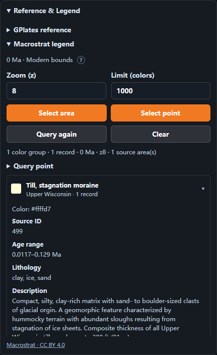

0 Ma 时直接查询所选现代范围；其他年代使用所选图层的板块模型将范围映射回现代，再按图例层级筛选相关区域。点选使用向四周各延伸 0.0001° 的小范围。多次查询结果按 ID 合并，并将相同颜色的记录组织在同一条目下。**Limit (colors)** 默认 `1000`，统计颜色组；超出时缩小选区再查询。部分请求失败时，已返回的结果仍会显示，并可通过 **Query again** 重试。查询范围是用于检索的近似区域，因此结果也可能包含邻近单元。

## 9. Camera & Output：视角和输出尺寸

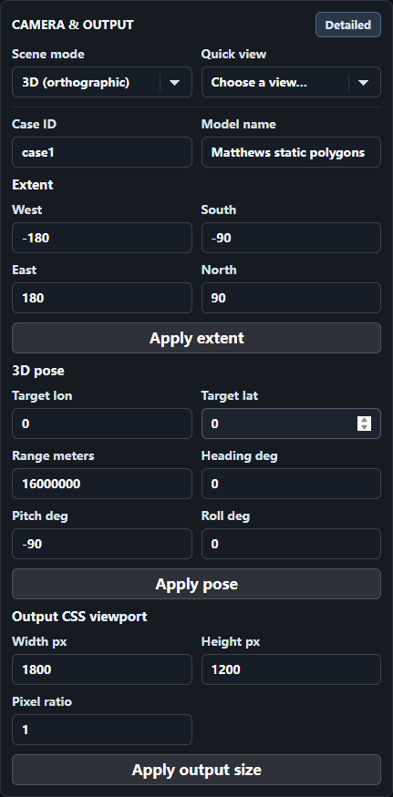

**Scene mode** 提供 **2D rectangular**、**3D (perspective)** 和 **3D (orthographic)**。**Quick view** 可快速转到本初子午线与赤道交点、日期变更线、南极或北极。

点击 **Detailed** 可进一步设置：

- **Case ID / Model name**：为实验输出填写标识。
- **Extent**：输入西、南、东、北边界后点击 **Apply extent**。
- **3D pose**：设置目标经纬度、距离和朝向，点击 **Apply pose**。
- **Output CSS viewport**：设置宽、高和 **Pixel ratio**，点击 **Apply output size**。导出的配套 JSON 记录实际画布像素尺寸。

## 10. Rendering：显示设置

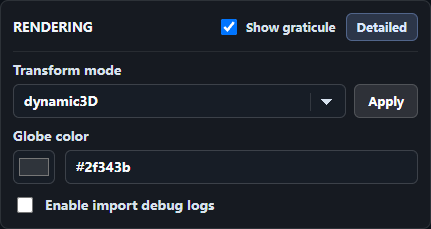

**Show graticule** 控制经纬网及坐标标注。点击 **Detailed** 可以设置地球底色、启用导入调试日志，以及选择变换模式并点击 **Apply**。`dynamic3D` 适合三维动态更新；`bakedInstance` 支持二维及其他场景下的实例变换。

## 11. Experiment 和 Runtime statistics

- **Import**：导入实验 JSON，恢复图层配置、年代和视角。导入后按第 2 节加载所需重建瓦片。
- **Export info**：下载当前配置和运行信息 JSON，便于记录与再次导入。
- **Screenshot**：下载地图 PNG 及配套 JSON。截图呈现地图本身；需要记录面板控件或图例列表时，可使用浏览器或系统截图。
- **Runtime statistics**：展开查看运行时统计信息。

实验 JSON 保存图层配置和本地文件描述。重新导入后，在右侧需要恢复的 TIFF 或 GeoJSON 图层选择 **Prepare local file**，重新选择文件并点击左侧 **Restore selected layer**；重建 TIFF 时还需确认 **Uses this model's present-day frame**。如果该层使用本地板块域或 ROT 文件，先点击 **Prepare local file**，再在左侧重新上传模型文件并对该层点击 **Use current**，然后完成 TIFF 文件的选择与恢复。在线服务重建层也可在重传模型后通过 **Use current** 更新，再加载瓦片。Macrostrat 图例选区和查询结果可在新会话中重新查询。
